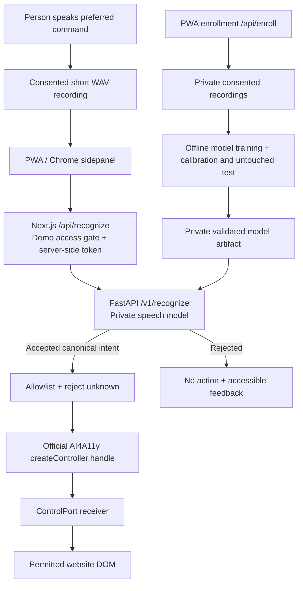

# Sauti Adapt architecture and trust boundaries

## Our intent
The co-designer chooses a handful of useful voice commands in Kenyan English and Kiswahili. We enroll speech samples only with consent. The running app freezes `facebook/wav2vec2-base` and compares each utterance with one prototype per command and language. It does not fine-tune the encoder. The notebook under `ml/notebooks` is not imported by the API, the PWA, or the extension. Only recognized, allowlisted commands are passed to the OFFICIAL AI4A11y Controller. No accuracy is claimed.

## Architecture

## What runs where?

* The Next.js PWA is on Vercel when deployed. The Controller runs **in the browser** and drives only DOM content within that PWA.
* The Chrome sidepanel captures voice. It forwards audio over HTTPS to the Next.js API proxy. After receiving an accepted label, its **content script** runs the official Controller inside the permitted page's isolated extension environment. A user must grant host permission before injection.
* The FastAPI service runs separately. `SPEECH_MODE=mock` is safe and rejects all audio. `SPEECH_MODE=prototype` loads frozen-encoder prototypes that passed separate calibration and untouched-test checks, including a correct activation for every command in each language it was enrolled in. That pass is not an accuracy claim.
* Android is NOT implemented by this starter. Building Android control needs a native accessibility service and a ControlPort adapter.

## Mapping to the official toolkit

Upstream: https://github.com/AI-for-Accessibility-Collective/AI-for-Accessibility-Toolkit
Pinned revision: `7cf5006dbab9e328fadf54b654147c6bca44113d`

* `controller/createController.js`: `createController({control,operator})`, `.handle(utterance)`.
* `controller/grammar.js`: deterministic known phrases including `scroll down`, `scroll up`, `go back`, `read this`, `undo`. `read this` returns the page text; Sauti then speaks that text with the browser `speechSynthesis` API. The speech is not recorded or uploaded. `undo` calls `undoLast`, which reverts the last display setting only. It does not undo scrolling or history navigation.
* `controller/router.js`: resolves and dispatches the utterance.
* `controller/web/dom-receiver.js`: `createDomReceiver(root, {scrollTarget})` with real DOM action implementation.
* `controller/control-port.js`: platform-neutral receiver contract.
* `controller/mount/index.js`: optional toolkit UI, not required because Sauti Adapt uses its own microphone capture to replace default `SpeechRecognition`.
* `docs/voice-mode.md`, `controller/PROTOCOL.md`: details of existing default speech input and remote receivers.

The toolkit's stock `controller/web/ui.js` creates browser `SpeechRecognition` configured to `en-US`. Sauti Adapt deliberately does **not** use that recognizer for personalized voice input. It still uses the genuine toolkit Controller/grammar/router/DOM receiver for actions.

## Machine learning protocol

1. Co-designer chooses commands and understands what is being recorded.
2. Enroll separate short sessions. Save identifiable voice only in a private, access-controlled directory.
3. A frozen pretrained `facebook/wav2vec2-base` extracts embeddings. Weights are not updated. This is a general model and not a validated Kenyan atypical-speech solution. Notebook experiments are not part of this path.
4. Compute normalized class prototypes by *intent and language* using ONLY enrollment sessions. This is not fine-tuning.
5. Reserve an entire held-out session, and include deliberate unknown speech recordings. Calibrate similarity and margin to avoid observed false activations. Release requires a correct activation for each command in each language it was enrolled in, reported separately for Kenyan English and Kiswahili. If that check fails, do not release the model. These counts are not an accuracy claim.
6. Test on new recordings and with the co-designer. Estimate error counts and latency. Small samples cannot establish very low false-activation risk.

`confidence` is a bounded cosine similarity score, **not** a calibrated probability of correctness. Do not interpret it as statistical confidence.

## Security and privacy

* The microphone stays off until the person presses the recording control. There is no background recording. Enrollment still requires the consent checkbox before a clip is stored.
* Clip length defaults to 5 seconds, with an optional auto-stop, and the listen control defaults to one toggle button. `SAUTI_MAX_CLIP_SECONDS` can change the server cap (invalid values stay at 5 seconds, and the cap cannot exceed 30). The server still rejects anything longer than its cap. Final length and the start/stop control must be agreed with the participant.
* Enrollment requires a consent flag, and cannot run until explicitly enabled on the API.
* Model and recordings live outside Git and public folders.
* Next.js protects demo endpoints using a shared team access code, then forwards a separate private backend token. This is suitable only for a controlled hackathon demo, NOT for public production.
* Release requires proper per-person authentication/authorization, deletion and retention controls, encrypted storage, rate limiting, privacy notices and abuse protection.
* A browser extension may hold host permission for its speech API, including a localhost app and `*.vercel.app`. That permission does not enable control. The person keeps a separate list of enabled website origins in extension storage. The content script rejects commands unless the current origin is on that list. Disable removes the origin. Browser-internal pages are refused.
* Do not claim Android or iOS system-wide control is provided by a browser PWA.
* No audio/transcripts or identifiable co-designer details go into test fixtures, the repo or model cards without appropriately scoped consent.

## Design limitations we must communicate

* The actual toolkit is fetched by bootstrap; it is NOT bundled in this ZIP.
* Installing npm dependencies and downloading Wav2Vec2 weights require network access.
* No model is trained or verified against a real co-designer here.
* A PWA installed on Android controls its own content, not other apps.
* The Chrome extension is not cross-browser tested and works only on permitted HTTP(S) sites. Browser-internal pages and some restricted contexts cannot be controlled.
* The model API's local filesystem may be ephemeral on some hosting providers; use private durable object storage before public release.
* On-device private inference and multi-device profile sync are later milestones.
